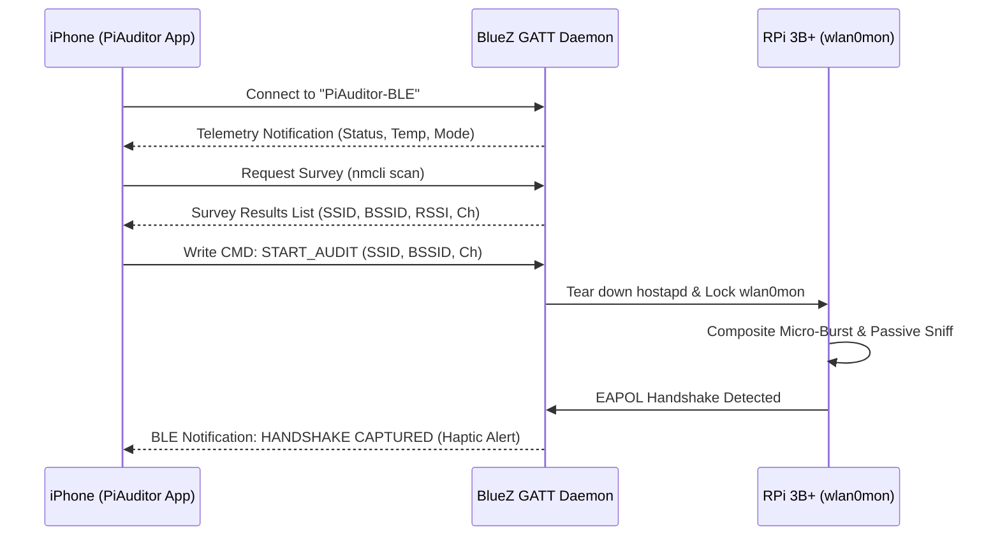

# PiAuditor-iOS

Autonomous Out-of-Band Wireless Assessment Controller for iOS & Raspberry Pi 3B+

[](https://opensource.org/licenses/MIT)
[](https://developer.apple.com/ios/)
[](https://www.kali.org/)

---

## Overview

When operating single-radio Wi-Fi assessment appliances (such as the Raspberry Pi 3B+ with Broadcom BCM43455), placing the radio (`wlan0`) into raw monitor mode (`wlan0mon`) requires tearing down the management Wi-Fi Access Point (`hostapd`).

**PiAuditor-iOS** solves the field control dilemma by providing an **Out-of-Band Bluetooth Low Energy (BLE GATT)** communication channel between your iPhone and the Raspberry Pi:
- **Zero Internet Disruption:** Your iPhone remains connected to 4G/5G mobile data. No Bluetooth PAN / tethering routing collisions.
- **Continuous Telemetry:** Monitor radio mode, channel lock, packet stream status, CPU temperature, and authentic 4-way handshake captures in real-time.
- **One-Tap Target Selection:** Trigger passive or active paced assessments directly from your phone.

---

## System Architecture



---

## Repository Layout

```
PiAuditor-iOS/
├── daemon/
│   ├── ble_auditor_daemon.py       # Python BlueZ D-Bus GATT Server
│   ├── ble-auditor.service         # Systemd unit file
│   └── install_pi_daemon.sh        # 1-Click setup script for Kali Pi
└── ios/
    ├── PiAuditor/
    │   ├── PiAuditorApp.swift      # SwiftUI App Entry
    │   ├── Models/
    │   │   ├── PiState.swift       # State & Telemetry Models
    │   │   └── WiFiNetwork.swift   # Discovered Network Model
    │   ├── Services/
    │   │   └── BLEManager.swift    # CoreBluetooth Central Manager
    │   ├── Views/
    │   │   ├── DashboardView.swift # Primary Control Dashboard
    │   │   ├── AuditControlView.swift # Parameter Tuning & Launch
    │   │   └── LogConsoleView.swift # Raw Event Log Console
    │   └── Info.plist
    └── project.yml                 # XcodeGen configuration
```

---

## Raspberry Pi Setup

1. Copy the daemon directory to your Raspberry Pi:
   ```bash
   scp -r daemon/ khoa@192.168.0.66:/home/khoa/wifi_auditor/
   ```
2. Log into your Pi and execute the installer:
   ```bash
   cd /home/khoa/wifi_auditor/
   sudo bash install_pi_daemon.sh
   ```
3. The daemon starts automatically at boot as `ble-auditor.service` and advertises as `PiAuditor-BLE`.

---

## iOS Sideloading & Building

### Option A: Using XcodeGen
```bash
cd ios
xcodegen generate
open PiAuditor.xcodeproj
```
Select your Development Team in Xcode and build directly to your connected iPhone.

### Option B: Pre-built IPA Sideload
Build the `.ipa` using your Apple Developer Certificate or sideload via **TrollStore**, **AltStore**, or **Sideloadly**.

---

## License

MIT License. Designed for authorized white-hat security testing and wireless research.
